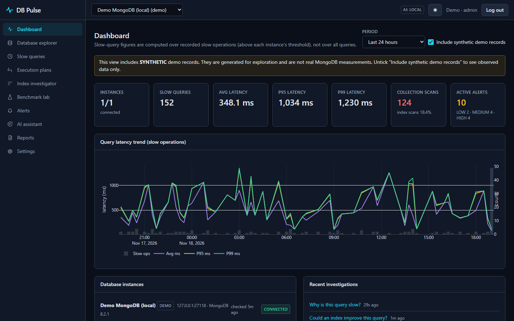
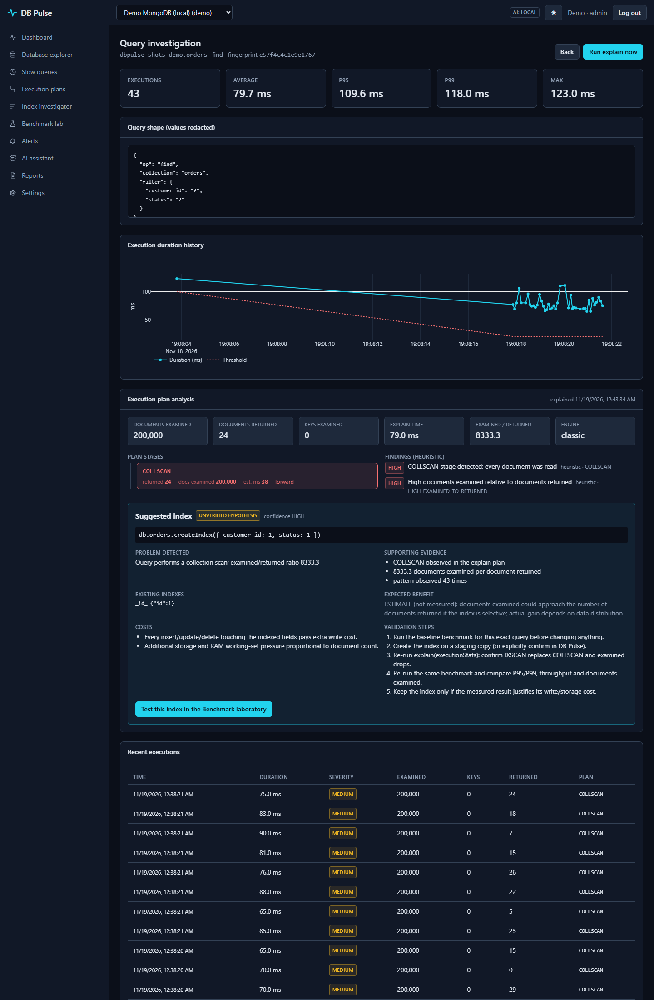
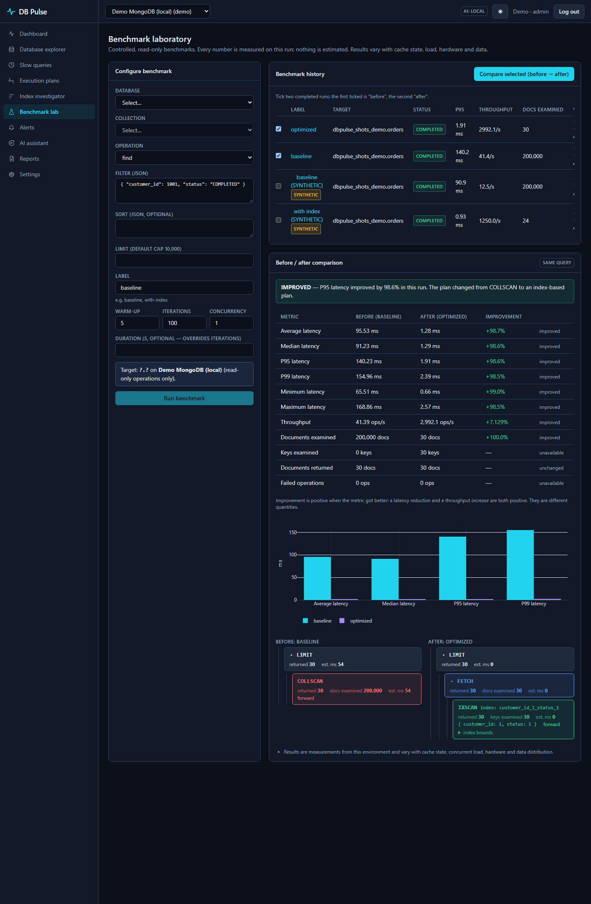
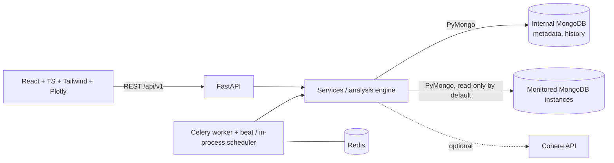

# DB Pulse

**An AI-assisted MongoDB performance investigation platform. Evidence first, recommendations second.**

DB Pulse connects to real MongoDB instances, reads the profiler and server statistics, runs real
`explain("executionStats")`, detects collection scans and inefficient queries, recommends indexes
*as unverified hypotheses*, and then **validates them with controlled benchmarks**. It never fabricates
measurements, never modifies a monitored database without explicit confirmation, and works fully
without any paid service (AI explanations via Cohere are optional; a deterministic local engine is the default).



| | |
|---|---|
|  |  |

More screenshots: [docs/screenshots/](docs/screenshots/) (login, explorer, slow queries, plans, indexes, alerts, AI assistant, reports, settings, light theme).

## What it does

- **Connections** — register multiple MongoDB instances; credentials encrypted at rest (Fernet), never returned by the API or logged.
- **Monitoring** — `serverStatus`, `dbStats`, op rates, latencies, connections; unavailable metrics are `null`/"—", never 0. Retention policy.
- **Profiler** — reads an existing `system.profile`; enabling it is an explicit, admin-only, confirmed action with previous config recorded and restorable.
- **Slow query detection** — per-collection/per-operation thresholds, fingerprinting (values never stored), pattern aggregation, alerts with dedup + cooldown.
- **Execution-plan engine** — recursive, defensive explain parser (classic + slot-based plans, find/count/aggregate, sharded shapes) and nuanced findings (a COLLSCAN on a small or low-selectivity query is *not* flagged as a problem).
- **Index investigator** — duplicate / redundant-prefix / unused indexes (with `$indexStats` caveats) and ESR-based recommendations with evidence, costs, validation steps and confidence.
- **Benchmark lab** — read-only, bounded, cancellable benchmarks (avg/median/P95/P99/min/max, throughput, docs/keys examined) and before/after comparison with correct polarity (latency *reduction* ≠ throughput *increase*).
- **AI assistant** — redacted structured evidence only; Cohere optional; automatic fallback to a local rule-based engine; measured facts are always computed locally.
- **Reports** — PDF / CSV / JSON; observed vs. estimated clearly separated; limitations listed.
- **Demo mode** — real demo dataset + clearly labelled `SYNTHETIC` history, with reset.

## Architecture



Modular monolith; internal metadata and monitored databases are strictly separate. Details: [docs/ARCHITECTURE.md](docs/ARCHITECTURE.md).

## Tech stack

Python 3.11+ (Docker image uses 3.12) · FastAPI · PyMongo · Pandas · Argon2 · JWT · Cohere SDK (optional) · Celery + Redis · ReportLab ·
React 18 + TypeScript (strict) + Vite + Tailwind + Plotly · Pytest + HTTPX + Playwright + Locust · Ruff + ESLint · Docker Compose.

## Prerequisites

Python 3.11+, Node.js 20+, MongoDB Community Server 7/8 (`mongod`). Docker is optional.

## Quick start (local, no Docker)

```powershell
# 1. two local MongoDB instances: 27117 = DB Pulse internal DB, 27118 = a "monitored" MongoDB
./scripts/dev_mongo.ps1            # Linux/macOS: ./scripts/dev_mongo.sh

# 2. backend
python -m venv .venv ; .\.venv\Scripts\Activate.ps1
pip install -r backend/requirements-dev.txt
python scripts/init_env.py         # writes .env with fresh SECRET_KEY / ENCRYPTION_KEY
cd backend ; uvicorn app.main:app --port 8000      # API docs: http://localhost:8000/docs

# 3. frontend (new terminal)
cd frontend ; npm install ; npm run dev            # http://localhost:5173  (proxies /api to :8000)
```

If port 8000 is busy, run uvicorn on another port and start the frontend with `VITE_API_PROXY=http://127.0.0.1:<port>`.

Register in the UI — **the first account becomes administrator**. Then click **Load demo** on the Dashboard.

## Docker

```bash
cp .env.example .env && python scripts/init_env.py --force
docker compose up --build        # UI http://localhost:8080 · API http://localhost:8000/docs
```

Services: frontend (nginx), backend, Celery worker+beat, internal MongoDB, a second "monitored" MongoDB, Redis — with health checks and named volumes.
> **Verification status:** the Compose file is validated statically (YAML + dependency references) but was **not executed** in the development environment (no Docker installed there). Treat the first `docker compose up` as unverified.

Ports: 8080 UI · 8000 API · 5173 Vite dev · 27117 internal MongoDB · 27118 monitored/demo MongoDB · 6379 Redis (internal).

## Configuration (`.env`)

See [.env.example](.env.example). Startup **fails fast** on missing/invalid `SECRET_KEY` (≥32 chars) or `ENCRYPTION_KEY` (Fernet key). Secrets are never committed (`.env` is git-ignored).

### Cohere (optional)

```env
AI_PROVIDER=cohere
COHERE_API_KEY=...
COHERE_MODEL=<a model available to your account>
```
The model is configurable and nothing assumes a free quota is permanent; check Cohere's current model list and rate limits. Any Cohere error (invalid key, rate limit, model not found, bad output) falls back to the local engine and the UI says why. Without a key the app is fully functional.
> **Verification status:** the Cohere integration is tested with a stub provider and a mocked SDK (error mapping, redaction, fallback). It was **not exercised against the live Cohere API** (no key available in development).

## Demo and the interview showcase

```bash
python scripts/demo_optimization.py --yes --rollback   # backend running; non-interactive, restores the DB afterwards
```
Generates a deterministic orders collection (seed 42, 200k docs), then: baseline `explain` + benchmark → investigation → **asks approval** → creates `{customer_id:1,status:1}` → re-test → compare → PDF/CSV/JSON report in `demo-output/`. Results are whatever MongoDB actually does; if the planner still chose a COLLSCAN the verdict would be `NOT_VALIDATED`.

Example measured run (Windows laptop, MongoDB 8.2.1, 200k docs; **your numbers will differ**):

| | before | after |
|---|---|---|
| plan | COLLSCAN | FETCH > IXSCAN |
| docs examined | 200,000 | 30 |
| P95 latency | 109 ms | 2.1 ms |
| throughput | 46 ops/s | 2,922 ops/s |

Other scripts: `seed_demo_data.py`, `generate_demo_workload.py` (real profiled queries), `create_test_database.py`, `setup_indexes.py`, `capture_explain_fixtures.py`, `capture_screenshots.py`.
Demo `SYNTHETIC` records are labelled everywhere and removable via **Demo reset** (`POST /api/v1/demo/reset`).

## Testing

```powershell
./scripts/dev_mongo.ps1
pytest                                   # 216 tests: unit, API, DB, integration, security, worker, and 17 Playwright UI tests
pytest backend/app/tests                 # fast unit tests only (no MongoDB needed)
locust -f automation/performance_tests/locustfile.py --headless -u 20 -r 5 -t 40s --host http://127.0.0.1:8000
cd frontend ; npm run typecheck ; npm run lint ; cd .. ; ruff check . ; ruff format --check .
```
Tests only touch databases named `dbpulse_test_*`. Strategy and results: [docs/TESTING_STRATEGY.md](docs/TESTING_STRATEGY.md).

## Security

Argon2 password hashing, short-lived JWTs, role-based access (admin/user), per-owner data isolation, encrypted credentials, redaction of query values, rate limiting, security headers, restricted CORS, safe error envelopes, read-only benchmark/explain with JS and write operators blocked. Details and threat notes: [docs/SECURITY.md](docs/SECURITY.md).

## MongoDB permissions needed

| Feature | Privilege |
|---|---|
| Connection test, version | `ping`, `buildInfo` (any user) |
| Database/collection listing | `listDatabases`, `listCollections` (else limited to own DBs) |
| Metrics | `serverStatus` (clusterMonitor), `dbStats`, `collStats` |
| Index analysis | `listIndexes`, `$indexStats` (`indexStats` action) |
| Profiler read | `find` on `<db>.system.profile` |
| Profiler enable / index create (opt-in, admin) | `dbAdmin` / `createIndex` — **not required for read-only use** |
| Explain / benchmark | `find` on the target collection |

## Limitations (read before trusting a number)

- The profiler only records what MongoDB profiled (level/`slowms`/sampling); it cannot see traffic it didn't profile. The optional `CommandListener` only observes an instrumented connection.
- `explain(executionStats)` executes the query; its time is not production latency. Explain formats vary by version; unparseable plans yield an explicit "unparseable" finding.
- `$indexStats` resets on restart; zero accesses ≠ safe to drop.
- Index recommendations are heuristics (ESR + existing indexes + sampled cardinality); they are unvalidated until benchmarked. Estimated benefits are labelled `ESTIMATE`.
- Benchmarks vary with cache, load, hardware and data; repeat before concluding.
- Rate limiting is in-memory (per process); use a shared store behind multiple workers.
- Docker stack and live Cohere were not run in development (see above).

## Documentation

[Architecture](docs/ARCHITECTURE.md) · [API](docs/API_DOCUMENTATION.md) (+ [openapi.json](docs/openapi.json), live at `/docs`) · [Database design](docs/DATABASE_DESIGN.md) · [Testing](docs/TESTING_STRATEGY.md) · [Security](docs/SECURITY.md) · [Troubleshooting](docs/TROUBLESHOOTING.md)

## License

MIT — see [LICENSE](LICENSE).
