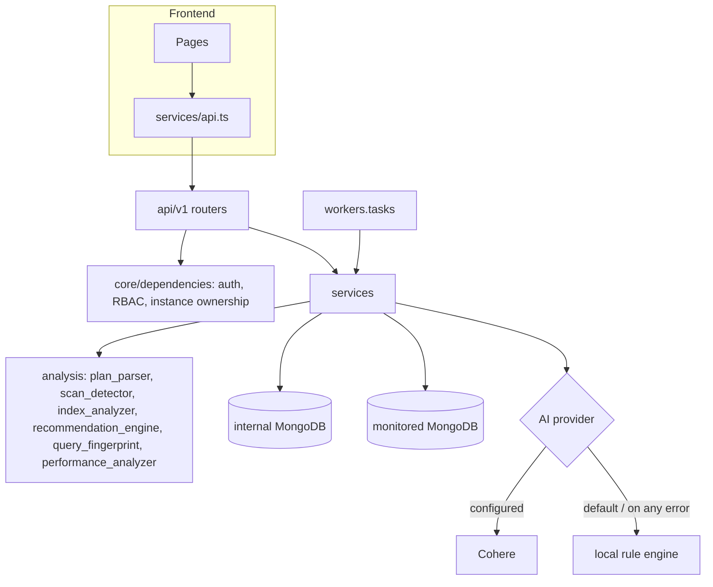

# Architecture

DB Pulse is a **modular monolith**: one FastAPI app, independently testable services, a pure-function analysis core, and a separate background worker that reuses the same service functions.

## Layers

| Layer | Responsibility |
|---|---|
| `api/v1/*` | HTTP only: validation (Pydantic), authz, mapping to services. |
| `services/*` | I/O and orchestration: connections, profiler, monitoring, slow-query ingestion, explain, index I/O, benchmarks, alerts, AI, reports, demo. |
| `analysis/*` | **Pure functions**, no I/O: heavily unit-tested against *recorded real explain output* (`backend/app/tests/fixtures`). |
| `repositories/*` | Persistence projections (e.g. instance `public()` whitelist so encrypted URIs cannot be serialized). |
| `workers/*` | `tasks.py` (plain functions) wrapped by an in-process scheduler (local) or Celery beat (Docker). |

## Key flows

**Detection:** profiler entry → `process_entry` (threshold: operation > collection > default) → fingerprint (value-free shape) → redacted record + encrypted latest sample on the pattern → alerts (dedup/cooldown) → pattern stats.

**Investigation:** decrypt sample (server-side only) → validated spec → real `explain` → parse → findings → index list + `$indexStats` + sampled cardinality → ESR recommendation → stored (raw explain encrypted at rest).

**Validation:** baseline benchmark → *explicit, confirmed* index creation (admin + instance opt-in) → same benchmark → `compare_runs` → verdict (`IMPROVED`/`REGRESSED`/`UNCHANGED`/`NOT_VALIDATED`/`INCONCLUSIVE`).

## Design decisions

- **Evidence vs hypothesis**: every finding is tagged heuristic; recommendations carry `status: unverified_hypothesis`; AI `observed_evidence` is computed locally even in Cohere mode.
- **Provenance**: `source: observed | SYNTHETIC` on every stored record; real and synthetic patterns may share a fingerprint, so lookups are source-aware (real preferred).
- **Safety defaults**: instances are registered read-only; profiler/index changes need admin + opt-in + confirmation flags; only indexes created by DB Pulse can be dropped by it.
- **Unavailable ≠ 0**: missing metrics are `null`; connectivity errors are failures (alert), permission errors are "unavailable".
- **Sync PyMongo + threadpool endpoints**: matches the required driver; benchmarks run in worker threads with cancellation flags.
